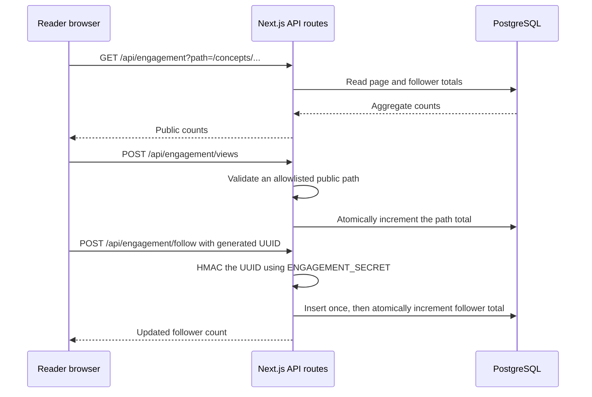

# Engagement counts: architecture, algorithm, and workflow

## Purpose

The engagement service provides two visible signals without requiring reader accounts:

- a per-public-page view total; and
- a follower total for readers who choose **Follow updates**.

It is an optional PostgreSQL-backed capability. When the required environment variables are absent, the UI says that follows will open soon and no request writes engagement data.

## Architecture

The browser never connects directly to PostgreSQL. `DATABASE_URL` and `ENGAGEMENT_SECRET` remain server-only Vercel environment variables. Content remains Git-backed MDX; the database stores engagement aggregates only.

## Counting algorithm

### Views

1. On the first visit to a public route in a browser session, `EngagementTracker` posts the path.
2. The API accepts only paths known from published MDX or the static-route allowlist. Drafts, unknown pages, query strings, and arbitrary URLs are rejected.
3. PostgreSQL uses `INSERT ... ON CONFLICT ... DO UPDATE` to increase a single row counter atomically.
4. Article pages retrieve and display the current aggregate after the browser hydrates.

This is a page-view counter, not a unique-person metric. A new browser session can create another view, similar to a lightweight public counter.

### Follows

1. The browser generates a UUID the first time the reader chooses Follow and saves it locally.
2. The API transforms that UUID into a SHA-256 HMAC using `ENGAGEMENT_SECRET`; the raw UUID is never stored.
3. PostgreSQL inserts the HMAC only if it has not been seen before.
4. The follower total increments in the same transaction only for a new HMAC.
5. Later clicks from the same browser return the current total without increasing it.

This represents anonymous browser follows, not verified people or newsletter subscribers. Clearing browser storage or using another device can create another follow. The product must not describe it as an exact count of people.

## Privacy boundaries

- No email addresses, names, passwords, IP addresses, or browsing profiles are stored by this feature.
- The UUID is pseudonymous and is HMAC-hashed before it reaches the database.
- The service does not send notifications. It signals interest in future articles and videos.
- Email notifications require a separate, explicit opt-in service with confirmation, unsubscribe handling, retention policy, and a provider such as Resend. Do not add an email field until that service is configured and reviewed.

## Database schema

`db/engagement.sql` creates three tables:

| Table                          | Purpose                                            |
| ------------------------------ | -------------------------------------------------- |
| `engagement_page_views`        | One aggregate counter per public path              |
| `engagement_followers`         | A singleton aggregate follower counter             |
| `engagement_follower_visitors` | HMAC hashes used only to prevent duplicate follows |

## Setup and release workflow

1. Create a managed PostgreSQL database, such as Neon or Supabase Postgres, in the Vercel region nearest the expected audience.
2. Put its pooled connection string in Vercel as `DATABASE_URL` for Preview and Production.
3. Generate a high-entropy secret and store it as `ENGAGEMENT_SECRET`; never commit either value.
4. Run `npm run db:migrate` once with `DATABASE_URL` set to create the tables.
5. Redeploy. The homepage follow card and article view counts become active.
6. Confirm a public page increments once per fresh browser session and a second click in one browser does not add another follower.
7. Update the privacy page with the selected database provider, retention period, backup owner, and deletion process before enabling the public production site.

## Operations

Monitor failed API responses, database connection saturation, and unexpected count spikes. Back up PostgreSQL according to the provider policy, restrict database credentials to Vercel server execution, and rotate `ENGAGEMENT_SECRET` only with a plan for existing deduplication records. Resetting the secret deliberately makes existing browser follow hashes incomparable, so it should be a rare privacy/security incident response.
