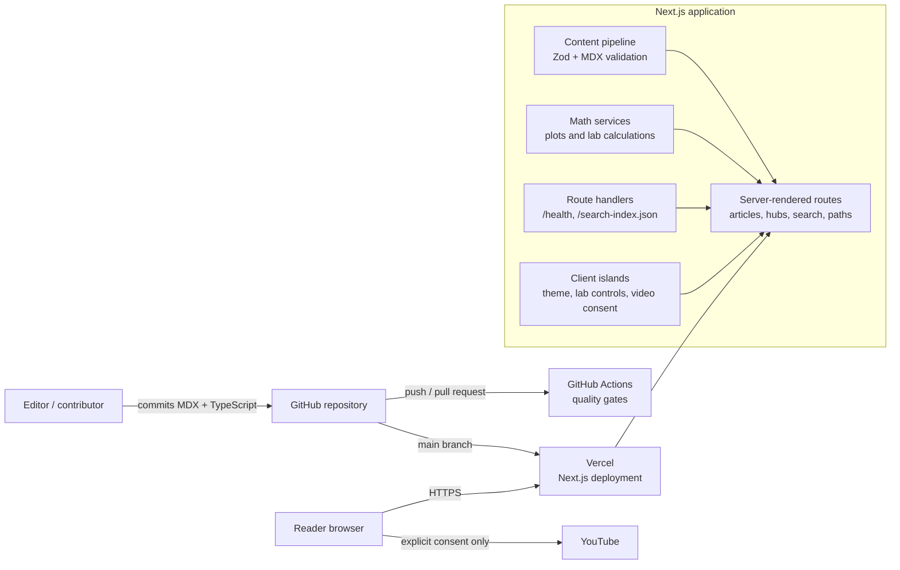

# Platform architecture

## Purpose

Beneath the Formula is a server-first mathematics exploration platform. Version 1 deliberately has no separate application server, CMS, user accounts, or database. Git-tracked MDX is the canonical content store, and Next.js builds it into secure, accessible pages.

## System map

## Front end

The front end is a Next.js 16 App Router application using React 19 and strict TypeScript. Most pages are server-rendered from validated content, which keeps initial pages fast and functional without JavaScript. CSS design tokens provide responsive layouts and light/dark themes. KaTeX renders mathematics locally.

Small client components are used only where interaction is required: the colour theme control, the secant-to-tangent SVG lab, copy-link interaction, and the consent gate that may load an approved YouTube embed. The browser never receives unpublished MDX records.

## Back end and content pipeline

There is no separate API service in version 1. The Next.js runtime and build pipeline are the backend:

1. Build scripts read MDX records from `content/`.
2. Zod schemas validate metadata, publication state, prerequisites, citations, video identifiers, internal links, and mathematical relationships.
3. Invalid, draft, unapproved, or broken records fail validation or remain excluded from public routes.
4. Next.js renders public content into pages and exposes a small JSON search index plus `/health`.
5. Security headers, redirects, robots rules, sitemap generation, metadata, and Open Graph images are applied at the web application layer.

This makes every public change reviewable in a pull request and traceable to a Git commit.

## Data storage

Git is the versioned content database for version 1. MDX front matter stores structured metadata, while body content stores the teaching material. It is appropriate because the platform currently has no per-user state, private data, transactions, or editorial collaboration workflow.

If future work adds accounts, saved progress, submissions, reactions, or a CMS, introduce PostgreSQL as a separate service. Recommended managed options are Vercel Postgres/Neon or Supabase Postgres. The Next.js server would then own database access through a typed repository layer; browser clients would call authenticated route handlers or server actions and would never use database credentials directly.

## Deployment topology

Vercel is the primary deployment target. GitHub `main` is the production source and pull requests can create protected preview deployments. GitHub Actions runs formatting, linting, TypeScript, content validation, unit tests, browser tests, and audit checks before a release is accepted. Vercel runs `npm ci` followed by `npm run build:deployment`.

Production configuration requires an owner-controlled HTTPS site URL and contact address. Editorial approval and hosting/privacy review must be confirmed through the existing release check before a public production release.

## Operational boundaries

- No credentials, private drafts, or user data belong in public MDX or browser code.
- YouTube is not contacted until a reader grants consent and an approved video ID exists.
- The application has no database backup burden today; GitHub history is the recovery source for content and code.
- A future database requires encrypted backups, migration ownership, retention policy, access controls, and a recovery drill before holding user data.
